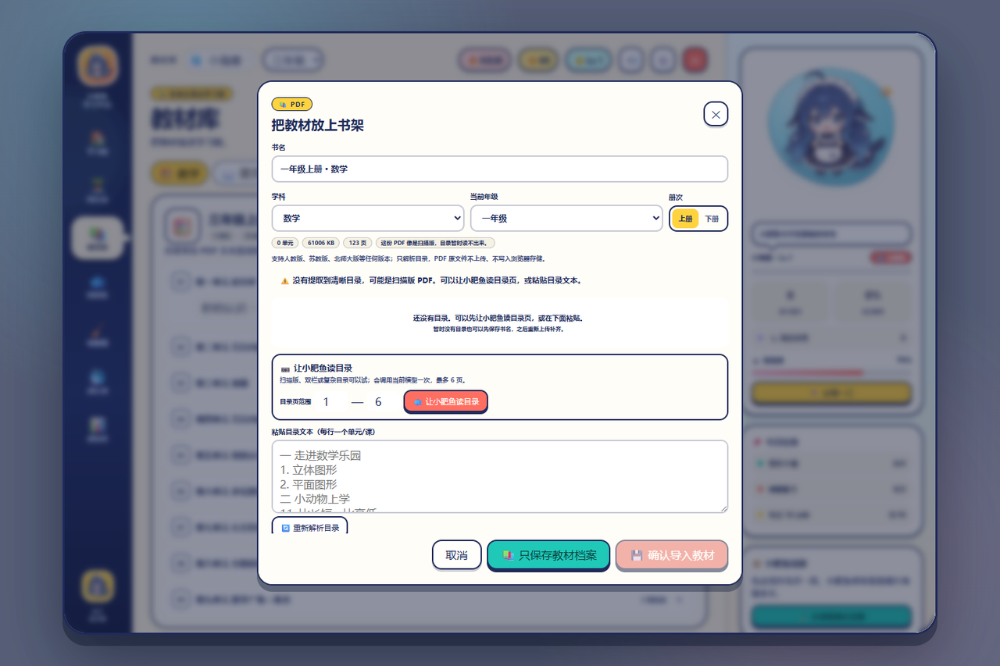

# 🐟 小肥鱼学习平台

一只住在 DeepSeek Harness 里的蓝色大肥鱼，把“学习”做成了海底糖果补习社。当前版本 **v1.2.1**。

装好插件后，有两个入口：左侧边栏会多出一行“小肥鱼学堂”，点开就是完整学习舱；页面右下角还留着一只探头的小肥鱼，随时可以弹出全屏版。

## 打开方式

- **左侧入口**：侧边栏 → “小肥鱼学堂”，直接把学习舱嵌进主内容区；点右上角 `↩` 返回对话。
- **右下角快捷入口**：小肥鱼头像 + “学习吗？小肥鱼请客！”，打开全屏浮层；右上角 `✕` 或 `Esc` 关闭。头像可以按住拖到屏幕任意位置，位置会记住；初始位置比旧版更贴近底边。
- 全屏浮层在超大屏上下留约 10% 空间，中小屏接近满屏并自动放大字号和块间距；窗口高度不足 900px 时优先保证清晰。
- 两个入口共用同一份学习进度。
- 进度自动保存在当前浏览器的 `localStorage`，不需要账号。
- 顶部头像可以切换/添加孩子；每个孩子有独立的学习档案、错题、贝壳和日记，教材库由全家共享。

## 里面有什么

| 区域 | 能做什么 |
| --- | --- |
| 学习档案 | 顶部头像切换孩子；支持添加/删除/切换，最多 6 个；每个孩子独立进度、错题、贝壳和日记 |
| 学习舱 | 今日任务、三科入口、专注计时、今日冷知识、小肥鱼状态、知识贝壳与日记 |
| 闯关岛 | 数学/语文/英语/混合，轻松/标准/挑战三档；数学按 1–6 年级动态出题 |
| 教材库 | 内置示例目录（1–6 年级，含上下册，仅作演示）；家长可上传任何版本 PDF 自动提取目录；把错题、变式挂到具体知识点 |
| 问问鱼 | 本地小助教：算式求解 + 分步讲解 + 知识点卡片 + 随机出题；超纲题可复制去问 DeepSeek |
| 错题礁 | 自动收集练习错题；家长拍照上传试卷/作业，由小肥鱼识题、分析错因和知识点后入库 |
| 变式再练 | 同一题型换数字/问法，连续答对 2 次才收进贝壳罐；答错掌握进度归零 |
| 成长湾 | 等级、经验、饱饱度、知识贝壳、6 种零食、6 件装扮、12 个成就、小肥鱼日记 |
| 成绩单 | 最近 7 天 / 30 天 / 本学期 / 自定义日期；生成可打印、可复制的学情报告 |
| 家长设置 | 昵称、年级、答题音效、重置进度 |

## 小设计

- **3 分钟一小关**：每关 4–7 题，答完立刻有星星、金币和夸张的鼓励。
- **错题有安全感**：错题不是“扣分”，而是“藏进错题礁的贝壳”，复习掌握后才消失。
- **学习能养成**：答对攒 XP 和金币，喂小鱼干、买学士帽/墨镜/泳圈，等级和饱饱度都有反馈。
- **本地优先**：题目、讲解、答疑、PDF 目录解析都在本地；拍照识题是唯一可选的模型调用。  
- **拍照识题是可选能力**：上传试卷/作业时，只有你点“让小肥鱼识题”才会调用一次当前模型；模型不支持图片时自动退回手动填写。  
- **教材对齐**：内置示例目录；家长可以上传人教版、苏教版、北师大版等任何版本 PDF 提取目录、粘贴目录修正，错题可挂到具体知识点。  
- **错题不是删掉就会**：变式连续答对 2 次才会变成知识贝壳；知识贝壳、小肥鱼日记、等级和饱饱度共同记录学习过程。  
- **报告可交付**：至少一周起，支持 7 天/30 天/本学期/自定义，生成可打印的学情报告。
- **数学用小朋友看得懂的样子**：不显示 LaTeX 或 `\frac` 代码；分数在界面里排成上下两行，`x=7/6` 会显示成真正的分数，`×`、`÷`、`π` 等符号也按小学课本习惯呈现。

## 真实教材 PDF 怎么导入

教材 PDF 有两种常见情况，不能用同一种“提取文字”办法硬解：

- **浙教版一年级上册数学**：123 页、约 59.6 MB，每页是一张扫描图，没有文字层、没有 PDF 书签。自动文字提取必然为空；目录在第 5 页，需要“看图识别”。
- **人教版一年级上册数学**：118 页、约 48 MB，有文字层，目录在第 5 页，但文字是按版面坐标和双栏排的。现在用**坐标分组 + 字号判断**解析，能自动得到 7 个单元：数学游戏、5以内数的认识和加、减法、6～10的认识和加、减法、认识立体图形、11～20的认识、20以内的进位加法、复习与关联。

所以导入流程现在有三条路：

1. **文字层自动解析**：有文字层的 PDF 直接按版面读目录，不调用模型。
2. **小肥鱼读目录页**：扫描版/复杂目录时，选“目录页范围”（最多 6 页），把小肥鱼真正需要看的几页渲染成图片，调用当前模型一次，返回单元和课时；不发送整本 PDF。
3. **手动粘贴 / 只保存档案**：粘贴 `一 走进数学乐园` 这样的目录文本也能建单元；实在没有目录时可以先保存教材档案，之后再补齐。

**导入还有意义吗？有，但它不是“上传一次就自动完美识别”。** 它的价值是：

- 把“这本书/这个版本/这个年级”与孩子的错题、知识点、练习关联起来；
- 有目录时，单元和知识点可以直接用来练、问、复习；
- 没有目录时，至少保留教材档案和教材架，不会再把人教版示例目录偷偷套到浙教版书上。




## 技术结构

```
xiaofeiyu-academy/
├─ package.json          # bundle 清单 + dsh.client
├─ cordis.patch.yml      # 插入 xiaofeiyu-academy 行
├─ index.js              # Host：资源、PDF.js、/health、/analyze-homework、/analyze-toc
├─ client.js             # Browser：sidebar.panellist + main + shell.overlay
├─ locale/{zh,en}.json   # 插件管理页标题/描述
├─ icon.png              # 插件图标（透明小肥鱼）
├─ assets/               # 小肥鱼形象、PDF.js、pep-curriculum.json
├─ docs/design.md        # 设计说明
└─ docs/preview-*.png    # 界面预览
```

教材目录数据在 `assets/pep-curriculum.json`，只是内置示例；家长上传其他版本后会进入“我的教材架”，同一学科/年级/册次可随时切换。PDF 解析使用 PDF.js（Apache-2.0，随包附带），文字层在本地解析；扫描版目录页只有在用户点击“让小肥鱼读目录”时，才会把选中的最多 6 页图片发给当前模型。

多孩子档案用 `children` + `activeChildId` + `childSnapshots` 保存：当前孩子的数据在根字段，其他孩子保存完整学习快照；切换时自动把当前快照写回，教材库和音效设置共享。数学文本由 `normalizeMathText()` 清理 LaTeX，再由 `MathText` 组件把 `a/b` 画成上下结构的真分数，而不是显示代码。

视觉资源复用本机 `dsh-pet` 的小肥鱼 IP（用户明确授权），按 dsh-pet 的素材许可仅供非商用；详见 `assets/README.md`。

## 设计语言

- [海底糖果设计语言规范](设计语言/xiaofeiyu-design-spec.md)
- [可视化设计语言导览](设计语言/xiaofeiyu-design-guide.html)
- [Design Tokens](设计语言/xiaofeiyu-design-tokens.css)

## 给别人安装

小肥鱼是 DSH 插件 bundle，不是一个独立网站。已经打好可直接分发的安装包：

- GitHub 仓库：https://github.com/MagicSandBag/xiaofeiyu-academy
- 最新 Release：https://github.com/MagicSandBag/xiaofeiyu-academy/releases/latest
- `release/xiaofeiyu-academy-1.2.1.tgz`（约 8 MB，含预览图、PDF.js 与安装说明）
- `release/xiaofeiyu-academy-v1.2.1-installer.zip`（GitHub Release 用 ASCII 文件名）
- `release/小肥鱼学习平台-v1.2.1-安装包.zip`（中文名安装包，内容相同）
- `release/update.json`（更新清单模板；发布前把 `example.com` 换成真实地址）
- [完整安装说明](安装说明.md)
- [更新与发布管理](docs/更新与发布.md)
- [版本记录](CHANGELOG.md)

接收方步骤：

1. 安装/更新 DeepSeek Harness 桌面版。
2. 打开左侧 **插件**。
3. 选择 **安装 bundle / 从本地安装**，选 `xiaofeiyu-academy-1.2.1.tgz`。
4. 启用 `xiaofeiyu-academy`，重启或刷新页面。
5. 左侧出现「小肥鱼学堂」，右下角出现小肥鱼头像。

如果插件管理器只有输入框，可填：

```text
file:C:/Users/你的用户名/Downloads/xiaofeiyu-academy-1.2.1.tgz
```

**不建议**直接把源码文件夹或 `node_modules` 发给别人；用 `.tgz` 最稳。要让更多人安装，可以把 tgz/zip 上传到 GitHub Release；如果发布到 npm，把 `package.json` 的 `private` 改为 `false`，再 `npm publish --access public`，别人就能按包名安装。

**后续更新**：v1.2.1 起，设置页 → 关于小肥鱼 → **检查更新** 会读取 GitHub 最新 Release，显示新版本、更新内容和下载按钮。下载后在 DSH 插件管理器里覆盖安装，学习数据会保留。本地 tgz 安装不会静默自动更新，仍需要用户确认安装；长期多人使用建议走 npm/私有 registry。完整流程见 [更新与发布管理](docs/更新与发布.md) 和 [CHANGELOG](CHANGELOG.md)。

安装包不含账号系统；学习数据只存在本机浏览器。拍照识题和扫描版目录识别仍取决于接收方当前模型的视觉能力与额度。

## 验证

- `node --check client.js` / `node --check index.js`
- 界面预览：[全屏浮层](docs/preview-home.png) · [宽屏全屏](docs/preview-overlay-wide.png) · [右下角入口](docs/preview-launcher.png) · [左侧嵌入面板](docs/preview-sidebar.png) · [学习档案](docs/preview-profiles.png) · [头像选择](docs/preview-avatar.png) · [教材库](docs/preview-library.png) · [文字层导入](docs/preview-import.png) · [扫描版导入](docs/preview-scan-import.png) · [数学真分数](docs/preview-math.png) · [变式再练](docs/preview-variant.png) · [学情报告](docs/preview-report.png) · [完赛成绩](docs/preview-result.png) · [移动端](docs/preview-mobile.png)
- 用 React UMD + Playwright 在本地 harness 中实际渲染并走通：左侧嵌入面板 + 浮层两个入口、首页 → 闯关 → 答题反馈 → 完赛成绩 → 答疑 → 出题/对答案 → 教材库 → 知识点详情 → PDF 目录导入 → 拍照/手动录入 → 变式再练 → 掌握贝壳 → 错题复习 → 任务领取 → 专注计时 → 7/30 天报告 → 设置保存 → 关闭，以及 390px 移动端布局。
- 已验证多孩子档案：添加“小贝壳”后错题为 0；切回“小海星”错题恢复为 1；刷新后仍是小海星；再切到小贝壳仍为 0。档案互不串数据。
- 头像选择改成 42px 大按钮：当前头像有高亮底、描边和右上角 ✓，下方还有“已选择 🐸”状态行；点击另一个头像会立即换选中。
- 已用用户提供的两份真实 PDF 验证：人教版 118 页 PDF 自动提取 7 个单元，并识别出“一年级上册 · 数学”；浙教版 123 页纯扫描 PDF 正确标记为扫描版、0 单元，显示“让小肥鱼读目录”与目录页范围 1–6，粘贴目录后可得到“一 走进数学乐园 / 二 小动物上学”2 个单元，并成功保存为“一年级上册 · 数学”。
- 用模拟目录识别响应验证了 AI 目录入口；真实模型识别取决于当前模型视觉能力和额度，失败会保留手动粘贴/只保存档案。
- 教材库不再给内置目录挂“人教版打样”标签：内置示例只显示单元/知识点数量，上传的教材才显示“我上传的教材”；页面文案统一为“把教材装进学习舱”。
- 已验证右下角入口：初始距底边 92px（移动端 82px），按住可拖到任意位置并记住坐标；拖动后不会误触打开，普通点击仍能打开。
- 已验证全屏布局：2560×1440 下学习舱约 2100×1152（上下各留约 10%，左右各留约 9%），1296×828 下约 1244×804；主标题、卡片间距、按钮和正文在宽屏自动放大，移动端恢复满屏单列。
- 已验证数学排版：存档里的 `x=\frac{7}{6}` 会清理成 `x=7/6`，错题卡/答疑/拍照预览都渲染为上下两行的真分数，页面文本不再出现 `\frac`。
- 已验证教材库不绑定版本：分别上传“苏教版三年级上册数学”和“北师大版三年级上册数学”，两本都进入“我的教材架”，可在同一学科/年级/册次间切换；页头只写“把教材装进学习舱”，不再暗示只能用人教版。
- 已用一份带文字层的示例 PDF 验证目录提取与“设为当前教材”；用一张示例作业图验证 `/analyze-homework` 返回 `question / studentAnswer / correctAnswer / analysis / knowledgePoint`；变式连续答对 2 次后错题移除、知识贝壳 +1。
- 已在当前 DSH profile 中安装并重新加载：`plugin_manager set_plugin` 返回 `application: applied`、无 warnings；`sidebar.panellist` 的“小肥鱼学堂”、`main` 的 `xiaofeiyu-academy`、`shell.overlay` 的快捷入口均 active；宿主 `/xiaofeiyu-academy/health` 返回 `version: 4`，`/analyze-toc` 已注册，PDF.js、教材 JSON 均返回 200。
